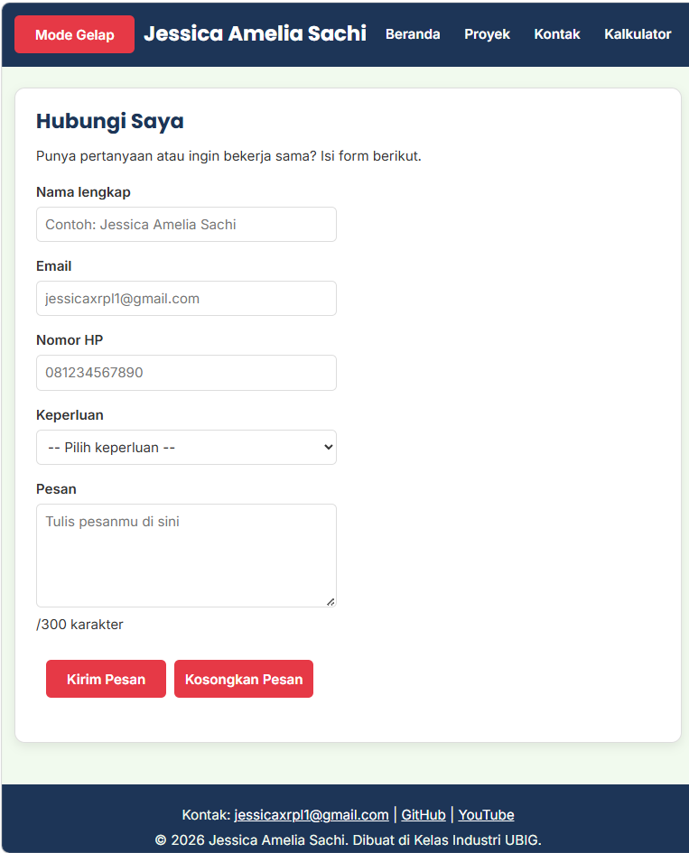

# Portofolio Jessica Amelia Sachi
Website portofolio pribadi yang saya buat di Kelas Industri UBIG (Paket 1, Minggu 01 sampai 05).
Website ini tampil rapi di ponsel, tablet, dan laptop.
## Tampilan

## Fitur
- Halaman **Beranda** berisi profil, hobi, cita-cita, keahlian, dan jadwal belajar
- Halaman **Proyek** berisi daftar proyek dalam bentuk kartu
- Halaman **Kontak** berisi form untuk menghubungi saya
- Tampilan responsif dengan Flexbox dan *media query*
- Halaman **Kalkulator Nilai** berisi form untuk menghitung rata-rata suatu nlai
- Tampilan mode gelap dan mode terang
- Penghitung pesan dalam mengirim pesan pada kontak maksimal 300 karakter
- Menampikan memuat pada repository 
- Tampilan soal yang dikerjakan di console
- Menghubungkan repository GitHub dengan project portofolio
- Tampilan keahlian JSON pada VsCode dan console (network)
- Tombol reset pesan pada kontak untuk menghapus form dengan cepat
## Teknologi
- HTML5
- CSS3 (Flexbox dan media query)
- Git dan GitHub
- JavaScript
- JSON
- README
## Tautan
- Website: menyusul setelah *deploy* ke Vercel
- Dibuat oleh: Jessica Amelia Sachi, SMKS BRANTAS KARANGKATES
- website: tugas-rumah-jessica.vercel.app
